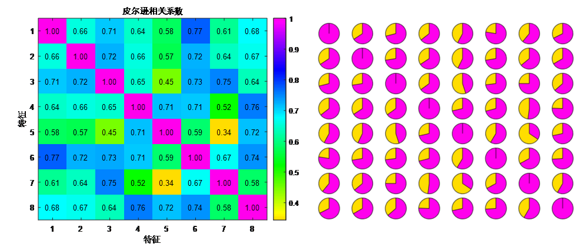
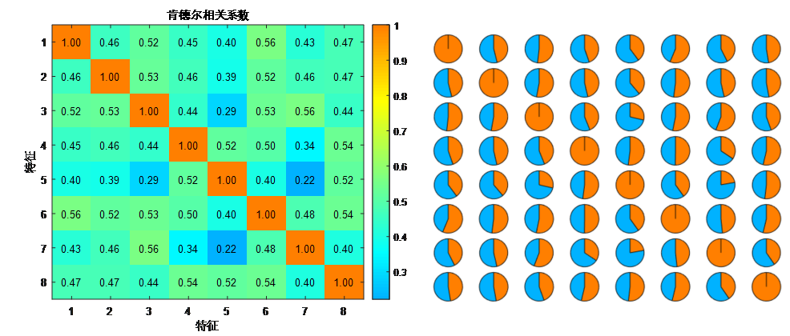
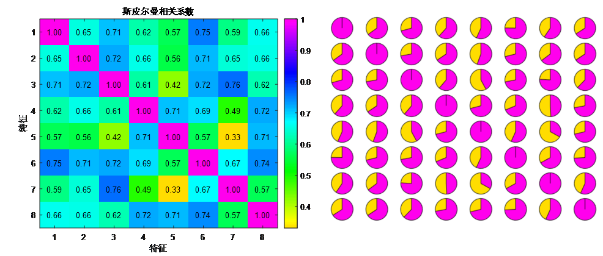
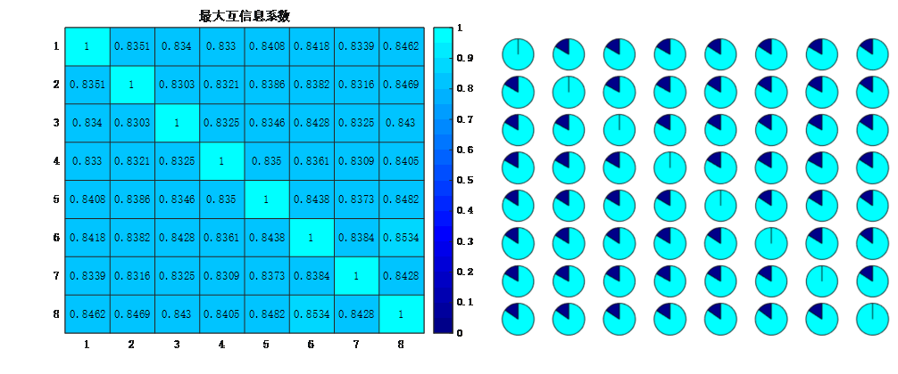
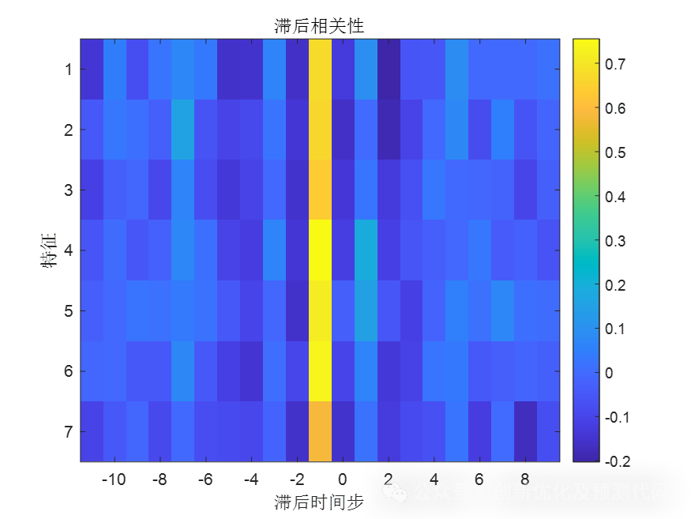

# Correlation analysis, one-click graph generation! Pearson, Spearman, Kendall, Maximal Mutual Information Coefficient (MIC), lag correlation analysis, directly run! Exclusive visualization program!

Applicable Platform: MATLAB 2020 and above

Correlation analysis is a statistical method used to measure the degree of relationship between two or more variables. Through correlation analysis, we can understand the interrelationships, dependence, and how they change with each other. Correlation analysis typically includes calculating correlation coefficients or other measures of association.
1. Quantify the degree of association between features: The value of the correlation coefficient allows us to judge whether their relationship is strong, moderate, or weak.
2. Feature dimensionality reduction: In large-scale datasets, correlation analysis can help us filter out variables that have weak relationships with the target sequence, thereby focusing on key features.
Dimensionality reduction methods: Pearson, Spearman, Kendall, Maximal Mutual Information Coefficient (MIC), Lag Correlation. Each type of correlation matrix should be plotted separately, and for each value in the matrix, a pie chart should be used to make it look more sophisticated! This enhances the reviewer's impression of the article.
Below are the characteristics of these types of correlation analysis:
Pearson correlation coefficient: The Pearson correlation coefficient measures the linear relationship between two variables. It calculates the covariance and standard deviation of the two variables. The Pearson correlation coefficient is very effective when dealing with data with strong linear relationships, with values ranging from -1 to 1, where positive values indicate a positive correlation, negative values indicate a negative correlation, and zero indicates no correlation.
Kendall correlation coefficient: The calculation process is similar to that of the Spearman correlation coefficient, but based on ranks instead of directly measuring linear relationships between ranks. It measures the consistency level between two variables' ranks, rather than directly measuring their rank differences. It is suitable for nonlinear relationships and is not sensitive to outliers, often used for rank data correlation analysis.
1. Spearman's Rank Correlation Coefficient: This is a nonparametric method based on rank order, used to measure the monotonic relationship between two variables. It involves converting the raw data of the variables into ranks and then calculating the Pearson correlation coefficient for these ranks. It is suitable for nonlinear relationships and is insensitive to outliers, with values ranging from -1 to 1.
2. Maximal Mutual Information Coefficient (MIC): This is a nonparametric method used to measure the nonlinear relationship between two variables. It divides the data space into grids and calculates mutual information within each grid to detect nonlinear relationships. It has good performance in detecting nonlinear relationships but is computationally complex.
3. Lag Correlation: Lag correlation measures the delayed relationship between two variables over time. It determines whether there is a lag relationship by calculating the correlation between variables at different time points. It is suitable for time series data and can reveal causal relationships over time.
In summary, each method has its own suitability for different scenarios and limitations. The choice of method depends on the characteristics of your data and the specific problem you are addressing. For linear correlation, Pearson's correlation coefficient is suitable, while for nonlinear or rank-order correlation, Spearman's and Kendall's correlation coefficients are considered. Lag correlation is suitable for time series data, while MIC is more appropriate for handling nonlinear relationships.

## Images

<!-- PAYMENT_BLOCK -->

## Get this dataset

- Payment link (Stripe): [Buy now](https://buy.stripe.com/3cs8yP7sY87d0vu9AB)
- Payment QR code: 

<!-- /PAYMENT_BLOCK -->
